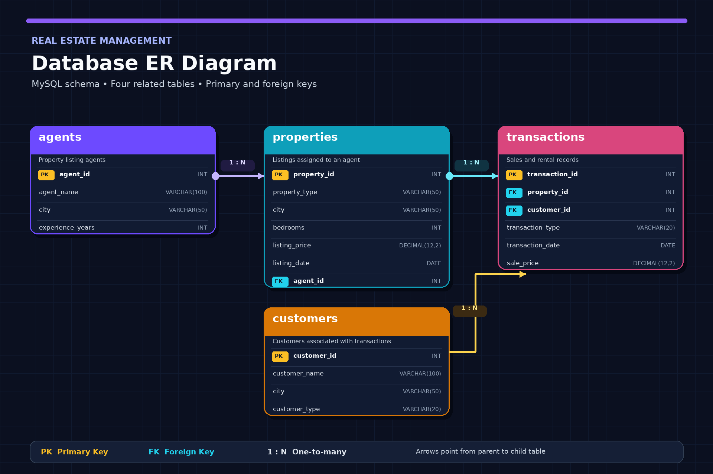
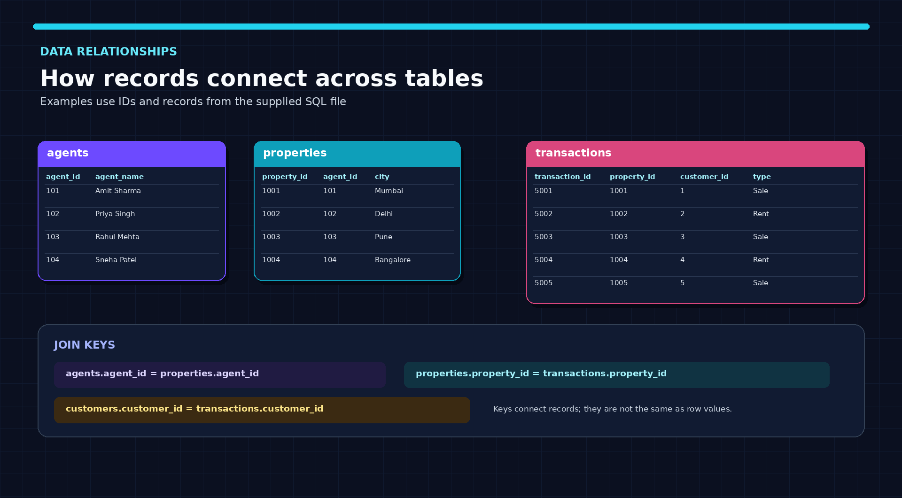

<div align="center">

# 🏡 Real Estate Management & Sales Analysis

### A MySQL portfolio project exploring property listings, customers, agents, sales, and rentals.


**From relational tables to business insights.**

</div>

---

## ✨ Project Overview

This project uses MySQL to model a small real-estate business and analyse property listings, agent activity, customer types, and recorded sale/rental transactions. The SQL script includes sample data and queries for filtering, joining, aggregating, ranking, and comparing records.

> **Dataset note:** The script uses five sample properties and five transactions. The records are illustrative and are not live real-estate market data.

## 🧭 Entity Relationship Diagram



### Relationship map

| Parent table | Child table | Relationship | Foreign-key connection |
|---|---|---|---|
| `agents` | `properties` | One-to-many | `properties.agent_id` → `agents.agent_id` |
| `properties` | `transactions` | One-to-many | `transactions.property_id` → `properties.property_id` |
| `customers` | `transactions` | One-to-many | `transactions.customer_id` → `customers.customer_id` |

**PK** = Primary Key, a unique identifier for a row. **FK** = Foreign Key, a column referencing a row in another table. **1:N** = one-to-many.

## 🗂️ Database Tables

### `agents`

| Column | Data type | Key | Description |
|---|---|---|---|
| `agent_id` | `INT` | PK | Unique agent identifier |
| `agent_name` | `VARCHAR(100)` | — | Agent name |
| `city` | `VARCHAR(50)` | — | Agent's city |
| `experience_years` | `INT` | — | Years of experience |

### `customers`

| Column | Data type | Key | Description |
|---|---|---|---|
| `customer_id` | `INT` | PK | Unique customer identifier |
| `customer_name` | `VARCHAR(100)` | — | Customer name |
| `city` | `VARCHAR(50)` | — | Customer's city |
| `customer_type` | `VARCHAR(20)` | — | Buyer or Tenant |

### `properties`

| Column | Data type | Key | Description |
|---|---|---|---|
| `property_id` | `INT` | PK | Unique property identifier |
| `property_type` | `VARCHAR(50)` | — | Type of property |
| `city` | `VARCHAR(50)` | — | Property location |
| `bedrooms` | `INT` | — | Number of bedrooms |
| `listing_price` | `DECIMAL(12,2)` | — | Listing price in the sample data |
| `listing_date` | `DATE` | — | Date the property was listed |
| `agent_id` | `INT` | FK | References `agents.agent_id` |

### `transactions`

| Column | Data type | Key | Description |
|---|---|---|---|
| `transaction_id` | `INT` | PK | Unique transaction identifier |
| `property_id` | `INT` | FK | References `properties.property_id` |
| `customer_id` | `INT` | FK | References `customers.customer_id` |
| `transaction_type` | `VARCHAR(20)` | — | `Sale` or `Rent` |
| `transaction_date` | `DATE` | — | Transaction date |
| `sale_price` | `DECIMAL(12,2)` | — | Amount recorded for the transaction |

## 🔗 Example Data Connections



The key joins used to combine the tables:

```sql
-- Agents and the properties assigned to them
SELECT
    a.agent_name,
    p.property_id,
    p.city,
    p.listing_price
FROM agents AS a
JOIN properties AS p
    ON a.agent_id = p.agent_id;

-- Transaction details with property and customer information
SELECT
    t.transaction_id,
    p.property_type,
    p.city,
    c.customer_name,
    t.transaction_type,
    t.transaction_date,
    t.sale_price
FROM transactions AS t
JOIN properties AS p
    ON t.property_id = p.property_id
JOIN customers AS c
    ON t.customer_id = c.customer_id;
```

## 🎯 Business Questions Explored

- How many properties, agents, and customers are in the database?
- Which properties are in Mumbai or have more than three bedrooms?
- Which listings have a price above ₹1 crore?
- What is the recorded sales revenue by city and property type?
- What is the average listing price and average recorded rent?
- Which agents have the highest recorded sales totals?
- Which sold property has the highest or lowest transaction amount?
- How are customers distributed between Buyer and Tenant types?
- How can properties be categorised into budget, mid-range, and luxury segments?
- How can sales be ranked by agent and listing price?

## 🧰 SQL Skills Demonstrated

- Database and table creation
- Primary keys and foreign keys
- `SELECT`, `WHERE`, `ORDER BY`, and `LIMIT`
- Aggregate functions: `COUNT()`, `SUM()`, `AVG()`
- `GROUP BY`, `HAVING`, and `CASE`
- `INNER JOIN` and `LEFT JOIN`
- Date functions: `YEAR()`, `MONTH()`, `MONTHNAME()`
- Common Table Expressions (CTEs)
- Window functions: `RANK()`, `ROW_NUMBER()`, `DENSE_RANK()`

## 🚀 How to Run

1. Install MySQL Server and open MySQL Workbench or another MySQL client.
2. Open `real_estate_analysis.sql`.
3. Run the database, table creation, and sample-data statements.
4. Execute the analysis queries and review the result sets.

### Repository Structure

```text
real-estate-management-sales-analysis/
├── README.md
├── real_estate_analysis.sql
└── assets/
    ├── real-estate-erd.png
    └── table-relationships.png
```

## 🧹 Notes Before Running the Full SQL Script

- The SQL file contains a second `CREATE TABLE agents` statement and repeated inserts/queries. Running the whole file in one pass can produce “table already exists” or duplicate primary-key errors. Keep one clean schema and seed-data section.
- `sale_price` is used to store both sale amounts and rental amounts. A clearer future schema could rename it to `transaction_amount`.
- The current conversion-rate query counts transactions for sold properties using a left join, but it should be reviewed carefully to ensure the denominator and distinct sold-property count match the intended business definition.
- The dataset is small and intended for SQL practice; use more records before drawing business conclusions.

## 👤 Author

**Pradip Kadam**

*MySQL · SQL · Relational Database Design · Data Analysis*
